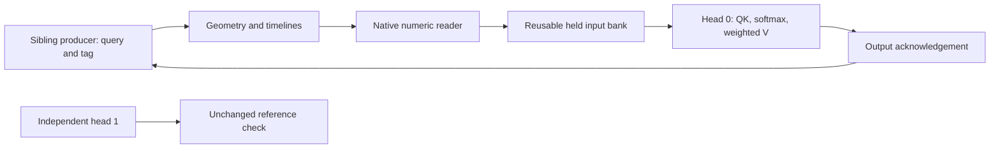

# Dataflow, locality and remaining design work

## Existing native dataflow

```mermaid
flowchart LR
    E[Token and position embedding] --> X[Residual input]
    X --> LN1[LayerNorm]
    LN1 --> QKV[Font QKV projection]
    QKV --> WRITE[Write selected layer and token K/V]
    WRITE --> QK[Font query-key products]
    QK --> SM[CSS softmax]
    SM --> V[Weighted cached values]
    V --> CP[Font attention projection and residual]
    CP --> LN2[LayerNorm]
    LN2 --> FC[Font FC and GELU]
    FC --> PROJ[Font projection and residual]
    PROJ --> LOOP[Native feedback register]
    LOOP --> X
    PROJ --> LAST[After last layer: final norm and full head]
```



The diagram is logical. The DOM uses nested numeric consumers, sibling geometry
sources, CSS property banks and timeline receivers. These physical relationships
determine which styles and geometry Chromium must reconsider.

## Three distinct kinds of unnecessary work

1. **Unnecessary computation:** creating score/value machinery for unpopulated
   slots, even when its contribution will be masked out. E1 addresses this.
2. **Unnecessary representation work:** shaping V again when only its scalar
   attention weight changes. R1 keeps an old V's font location unchanged while
   that layer stays selected and the stored V itself does not change.
3. **Unnecessary invalidation:** unrelated nodes receive or are affected by input
   and control changes. S1 narrows explicit data exposure; the separate locality
   probe tests moving the originating mutation itself into its owner's subtree.

These must be measured separately. A reduction in fields, DOM nodes or font
instances does not automatically imply lower runtime.

## Implemented ownership change and its limits

S1 changes exported cache aliases (`--fr-*`) from inherited to non-inherited.
Active-layer selection still happens on the native bank. Explicit forwarding
preserves aliases along the shared storage/consumer spine, then narrows the
imports at actual consumers:

| Element | Required cache data after S1 |
|---|---|
| Score glyph for head H, slot S | K vector H/S and its scale |
| Softmax reader | Scales required for normalization plus active-layer aliases |
| Output row for head H | V vectors/scales for that head's slots |
| V glyph for head H, slot S | V vector H/S and its scale |

This preserves the existing bank mechanism and works numerically, but introduces
many explicit forwarding declarations. In the initial matched screens it is
slower than the baseline. Therefore this representation is not promoted.

S1 does not claim that CSS physically copied every field before the change.
It also does not isolate the shared source/control ancestors: those still have
legitimate dependencies on the active layer's inputs.

## The stronger ownership design

The separate locality probe compares two locations for the **same input mutation**:

```text
Broadcast version                 Owned version
body receives head-0 query        head-0 receives head-0 query
├─ head 0: uses it                ├─ head 0: uses it
├─ head 1: unchanged result       ├─ head 1: unchanged result
└─ other heads/storage            └─ other heads/storage
```

Each head owns font QK, numeric softmax and weighted-value arithmetic. K/V are
immutable fixture literals, not production transition-backed registers. This
allows the invalidation hypothesis to be tested without pretending that the
production cache and scheduler have already been restructured.

To transfer a positive result into native inference, the compiler needs to:

- Construct query/key/value input representations at a head or stage boundary.
- Keep its changing control properties off unrelated ancestors.
- Maintain native per-layer storage without broadcasting whole caches through
  every consumer subtree.
- Export only outputs required by the next stage, with a freshness contract.
- Validate all-head completion before the output projection consumes the vector.

Duplicating a complete graph twelve times is not automatically a solution:
extra retained font/style state and more cross-subtree transfers can outweigh
the benefit. The independently correct head-local diagnostic is a hypothesis
test, not a drop-in runtime implementation.

All twelve queries change during a normal full-layer pass. The one-head mutation
diagnostic is useful for exposing collateral work, but it does not establish
that the same ratio survives when every head has real work to do. An integration
must compare that all-head operation and inspect inactive banks/stages as well.

## Native transfer and held-input proof

The [local-commit follow-up](native-local-commits.md) implements a bounded part of
that stronger design:



The producer's raw fields cannot inherit into head 0. After the reader captures
each input, native acknowledgements hold the bank before the producer is poisoned.
Audit registers retain the held query, output and changed incoming source. Three
fresh browser processes completed all nine A→B→A commits without post-navigation
writes; a delayed-observation case completed before the first computed-style read.

This is one serialized 64-coordinate bank with immutable K/V fixture values. It
proves capture, freshness, retention and reuse for that mechanism. It does not
implement twelve-head completion, layer cache writes, a fully autonomous model,
or a matched style/time comparison against broadcast input. Those remain separate
integration and measurement requirements.

## What “fusion” can mean here

The current compiler already performs several useful fusions:

- QK score decoding and softmax declarations live on the same reader element.
- Font projection readback includes bias arithmetic.
- Attention/output projection readers include their residual addition.
- FC readback includes GELU before publishing the hidden activation.

Consequently a generic recommendation to “fuse bias/GELU/softmax” repeats existing
work. The baseline already derives normalized axis lists/scales. F1, retained
under the CLI label `materialize`, tests **raw-property lifetime** by resetting
raw QKV before the cache subtree. It does not add that derivation or remove a
font/timeline operation. Derived aliases and controls still change, and sibling
branches still inherit raw QKV; this is not a global end-of-lifetime boundary.

Further operator fusion would need to remove a real boundary. For example,
weighted-V widths cannot simply be fed to the next variable font: its axes need
numbers, which currently requires native geometry-to-number transport. A proposed
combined operator must show how all 768 coordinates reach the next font and how
freshness is maintained. No fast hypothetical fused operator is included in the
measurements. This remains design work unless a native implementation is tested.

## Stage controls and containment

The existing full runtime already makes layer control private and moves its
container away from the vocabulary head. C1 additionally narrows internal score
timeline scope. C1 alone does not create a per-stage commit protocol.

Inactive stages cannot simply be removed without considering the transition
registers and timeline geometry used for feedback. Their state must survive any
visibility change. E1 hides only unpopulated score/value computations and corrects
their removed positive glyph bases; it does not hide persistent K/V banks.

Containment ablations preserve explicit scroller dimensions and compare `strict`,
`size layout`, and `none` on the attention sources. They test this particular
geometry. They do not establish that containment generally prevents style
invalidation or is safe on every producer/consumer boundary.

## Interpretation of a successful next step

A real integration win must satisfy all three conditions:

1. Fewer unrelated elements incur browser work when a stage input changes.
2. Native layer feedback and cache retention remain correct without external
   stage ticks or JavaScript.
3. The complete pipeline gets faster or uses materially less memory at matched
   capacity and quality. Component percentages cannot be applied to token time.

See the measured outcomes and their evidence levels in [RESULTS.md](RESULTS.md),
[MEASUREMENTS.md](MEASUREMENTS.md), [locality-report.md](locality-report.md), and
[native-report.md](native-report.md).
