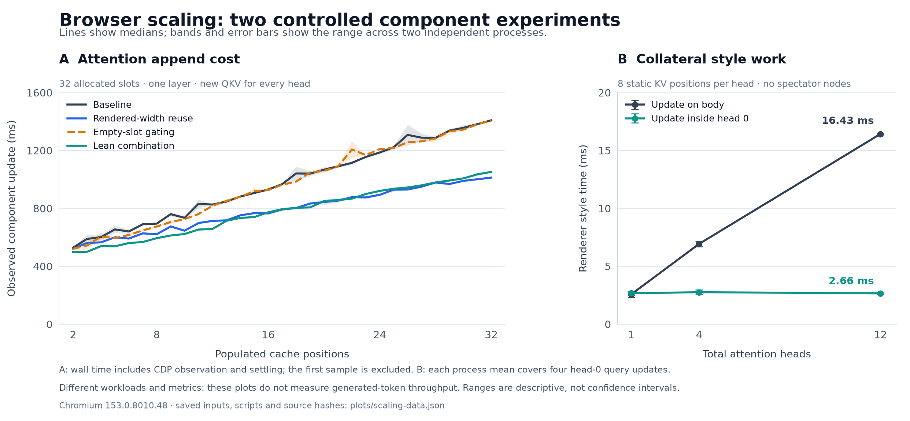

# Saved scaling measurements

Generated by `python3 tools/summarize_browser_gpt2_scaling_investigation.py`. This report uses saved files only. Rerun after new browser measurements finish. Every source result and its SHA-256 are listed in [investigation.json](investigation.json).

The [architecture review](ARCHITECTURE.md) covers the production graph and remaining design work. [Native pipeline experiments](native-report.md) report integration evidence separately from the attention and locality measurements below. The [locality report](locality-report.md) interprets the independent head-ownership curves.

Snapshot: **47/47 passing attention cases**; **24/24 passing locality cases**; **12/12 passing locality traces**; **3/3 passing native-commit cases** (9/9 commits); **1 separately preserved failed attempts**; 0 unreadable files.

## What the numbers mean

These attention runs supply QKV, position, layer and generation controls externally through CDP. The browser retains KV and computes attention without page JavaScript. They omit embedding, QKV/output projection, MLP, vocabulary scoring and autonomous scheduling. Milliseconds below are per component update, never per generated token.

Capacity is allocated cache slots; populated positions are how far the run appends before query probes. Each append summary mixes positions 2 through that final position for one layer. For multiple layers it also includes the initial visits to layers after layer 0. Query probes use the final populated position. An early-prefix append average is not a full-context latency. The per-position/layer JSON preserves this distinction.

Wall values are medians of independent process medians. Renderer values are medians of per-process means. Wall ranges show process medians, not individual-update extremes. Repeated updates inside one browser process are not independent repetitions. With one or two processes, these are descriptive ranges rather than confidence intervals.

Configuration pass counts and archived failed-attempt counts are distinct: a successful retry does not turn its earlier failure into a passing attempt. Native pipeline runs remain in the separate native report rather than this inventory. Only complete passing runs contribute aggregate timings and baseline comparisons. All failures and incomplete files remain in the inventory below. Correctness uses a deterministic synthetic fixture and a 768-coordinate reference, RMSE < 0.005; maximum error is retained. It does not establish full-model quality or behavior on other prompts.

Wall time includes writing a complete inline style attribute, two computed-style reads per settling poll, and at least three 25 ms sleeps. Those reads can force browser work. Renderer style/layout totals help distinguish work reduction from polling and protocol cost, but are not pure isolated algorithm timings. RSS is a 0.5 s sampled process sum and can miss short peaks; it is not macOS physical footprint, and sums can double-count shared memory.

`query-only` means only 64 query numbers change numerically for a **single selected layer**, while K/V and position stay fixed. The harness still rewrites all input declarations and advances the global generation marker. With multiple layers, these rows also switch the active layer and expose that layer's K/V: interpret them as **query plus layer switch**. They do not establish head-local invalidation in the production graph.

## Scaling figure

The panels show different component workloads and metrics. Lines are medians; bands/error bars are ranges across two independent processes. [PNG](plots/scaling-investigation.png), [SVG](plots/scaling-investigation.svg), [source data and input hashes](plots/scaling-data.json), [render manifest](plots/render-manifest.json).

## Attention cases, separated by design and recorded revision

### Capacity 32; populated 32; layers 1; query updates/layer 3; source `5cf598a37b91`

Browser: `Chrome/153.0.8010.48`. Population is 32/32 slots. Query rows retain the same active layer.

**append**

| Variant | Pass/runs | Repeats | Updates/run | Wall ms | Wall range ms | Style ms | Layout ms | Task ms | Peak renderer MiB | Worst RMSE |
| --- | --- | --- | --- | --- | --- | --- | --- | --- | --- | --- |
| baseline | 2/2 | 0, 1 | 31, 31 | 967.9 | 966.0–969.7 | 141.2 | 418.7 | 765.0 | 1244.4–1246.4 | 0.000895 |
| empty | 2/2 | 0, 1 | 31, 31 | 963.2 | 962.3–964.1 | 144.3 | 409.1 | 747.4 | 1059.5–1104.7 | 0.000863 |
| lean | 2/2 | 0, 1 | 31, 31 | 794.6 | 790.0–799.2 | 147.3 | 237.9 | 552.4 | 1158.1–1160.9 | 0.000610 |
| widths | 2/2 | 0, 1 | 31, 31 | 792.7 | 784.7–800.7 | 148.6 | 246.1 | 570.0 | 1217.5–1238.7 | 0.000609 |

**query-only**

| Variant | Pass/runs | Repeats | Updates/run | Wall ms | Wall range ms | Style ms | Layout ms | Task ms | Peak renderer MiB | Worst RMSE |
| --- | --- | --- | --- | --- | --- | --- | --- | --- | --- | --- |
| baseline | 2/2 | 0, 1 | 3, 3 | 570.1 | 565.8–574.3 | 155.3 | 66.2 | 380.5 | 1244.4–1246.4 | 0.000895 |
| empty | 2/2 | 0, 1 | 3, 3 | 591.1 | 584.3–597.9 | 175.0 | 65.8 | 398.6 | 1059.5–1104.7 | 0.000863 |
| lean | 2/2 | 0, 1 | 3, 3 | 578.4 | 577.1–579.7 | 187.1 | 36.1 | 371.5 | 1158.1–1160.9 | 0.000610 |
| widths | 2/2 | 0, 1 | 3, 3 | 590.4 | 554.0–626.9 | 168.3 | 36.0 | 353.6 | 1217.5–1238.7 | 0.000609 |

Matched baseline comparisons: positive reduction means less wall time; negative means slower. Pairs use the same repeat ID and recorded source revision. No significance test is implied.

| Variant | Update | Pairs | Median reduction % | Pair range % |
| --- | --- | --- | --- | --- |
| empty | append | 2 | 0.5 | 0.2–0.8 |
| empty | query-only | 2 | -3.7 | -4.1–-3.3 |
| lean | append | 2 | 17.9 | 17.3–18.5 |
| lean | query-only | 2 | -1.5 | -2.5–-0.5 |
| widths | append | 2 | 18.1 | 17.1–19.1 |
| widths | query-only | 2 | -3.5 | -9.2–2.1 |

**Append checkpoints within this fixed-capacity run**

These rows keep population fixed rather than mixing the growing prefix. For multiple layers, wall time is the per-process median across that position's layer updates, then the median across processes; renderer values are the corresponding process means. They are still per-layer component updates, not token latency. Every position and individual layer is retained in JSON.

| Variant | Populated position | Runs | Layer updates/run | Wall ms | Wall range ms | Style ms | Layout ms |
| --- | --- | --- | --- | --- | --- | --- | --- |
| baseline | 2 | 2 | 1, 1 | 529.0 | 522.4–535.6 | 97.4 | 67.5 |
| baseline | 4 | 2 | 1, 1 | 601.2 | 581.9–620.5 | 102.3 | 115.4 |
| baseline | 8 | 2 | 1, 1 | 694.8 | 694.8–694.9 | 107.3 | 203.8 |
| baseline | 16 | 2 | 1, 1 | 930.6 | 922.2–939.0 | 140.5 | 388.0 |
| baseline | 32 | 2 | 1, 1 | 1408.7 | 1405.3–1412.2 | 175.1 | 758.3 |
| empty | 2 | 2 | 1, 1 | 520.8 | 498.8–542.8 | 104.4 | 49.4 |
| empty | 4 | 2 | 1, 1 | 605.6 | 577.9–633.3 | 97.9 | 95.0 |
| empty | 8 | 2 | 1, 1 | 675.1 | 667.1–683.2 | 106.5 | 191.7 |
| empty | 16 | 2 | 1, 1 | 927.0 | 919.7–934.3 | 144.2 | 386.9 |
| empty | 32 | 2 | 1, 1 | 1407.2 | 1401.7–1412.7 | 188.8 | 752.0 |
| lean | 2 | 2 | 1, 1 | 498.8 | 497.8–499.8 | 105.0 | 40.0 |
| lean | 4 | 2 | 1, 1 | 539.0 | 535.5–542.4 | 97.0 | 63.6 |
| lean | 8 | 2 | 1, 1 | 594.1 | 590.6–597.7 | 111.6 | 116.0 |
| lean | 16 | 2 | 1, 1 | 773.2 | 770.7–775.6 | 148.3 | 238.9 |
| lean | 32 | 2 | 1, 1 | 1052.3 | 1051.9–1052.7 | 194.8 | 433.6 |
| widths | 2 | 2 | 1, 1 | 522.0 | 519.3–524.6 | 98.0 | 61.6 |
| widths | 4 | 2 | 1, 1 | 565.2 | 560.5–570.0 | 107.0 | 87.1 |
| widths | 8 | 2 | 1, 1 | 621.5 | 619.4–623.5 | 116.3 | 130.8 |
| widths | 16 | 2 | 1, 1 | 765.6 | 755.3–776.0 | 147.4 | 227.7 |
| widths | 32 | 2 | 1, 1 | 1012.9 | 1003.8–1022.0 | 185.2 | 419.4 |

### Capacity 32; populated 4; layers 1; query updates/layer 3; source `03e7440ac1a4`

Browser: `Chrome/153.0.8010.48`. Population is 4/32 slots. Query rows retain the same active layer.

**append**

| Variant | Pass/runs | Repeats | Updates/run | Wall ms | Wall range ms | Style ms | Layout ms | Task ms | Peak renderer MiB | Worst RMSE |
| --- | --- | --- | --- | --- | --- | --- | --- | --- | --- | --- |
| baseline | 2/2 | 0, 1 | 3, 3 | 584.9 | 570.7–599.0 | 103.3 | 92.7 | 337.9 | 940.3–969.8 | 0.000704 |
| combined | 2/2 | 0, 1 | 3, 3 | 1025.4 | 1021.9–1028.9 | 594.5 | 55.6 | 803.2 | 1117.2–1315.8 | 0.000461 |
| contain-layout | 2/2 | 0, 1 | 3, 3 | 575.4 | 566.7–584.1 | 103.2 | 91.7 | 337.3 | 970.9–1008.7 | 0.000704 |
| contain-none | 2/2 | 0, 1 | 3, 3 | 586.3 | 580.4–592.2 | 102.6 | 91.4 | 337.1 | 883.5–926.2 | 0.000704 |
| empty | 2/2 | 0, 1 | 3, 3 | 526.2 | 520.0–532.4 | 98.1 | 71.6 | 308.4 | 897.9–913.1 | 0.000474 |
| fields | 2/2 | 0, 1 | 3, 3 | 986.2 | 978.5–993.9 | 525.8 | 97.4 | 811.9 | 1124.2–1197.9 | 0.000704 |
| lean | 2/2 | 0, 1 | 3, 3 | 502.3 | 499.2–505.5 | 100.7 | 51.8 | 288.9 | 881.8–937.2 | 0.000461 |
| materialize | 2/2 | 0, 1 | 3, 3 | 573.4 | 568.4–578.3 | 104.0 | 91.3 | 336.0 | 912.5–1014.0 | 0.000704 |
| timelines | 2/2 | 0, 1 | 3, 3 | 579.9 | 566.5–593.4 | 102.3 | 91.5 | 337.4 | 897.2–941.4 | 0.000704 |
| widths | 2/2 | 0, 1 | 3, 3 | 574.6 | 568.9–580.3 | 111.7 | 75.6 | 329.8 | 891.5–987.7 | 0.000449 |

**query-only**

| Variant | Pass/runs | Repeats | Updates/run | Wall ms | Wall range ms | Style ms | Layout ms | Task ms | Peak renderer MiB | Worst RMSE |
| --- | --- | --- | --- | --- | --- | --- | --- | --- | --- | --- |
| baseline | 2/2 | 0, 1 | 3, 3 | 500.1 | 467.1–533.0 | 107.1 | 12.1 | 236.3 | 940.3–969.8 | 0.000704 |
| combined | 2/2 | 0, 1 | 3, 3 | 946.1 | 943.5–948.7 | 599.0 | 6.3 | 750.5 | 1117.2–1315.8 | 0.000461 |
| contain-layout | 2/2 | 0, 1 | 3, 3 | 461.8 | 459.1–464.4 | 103.9 | 11.1 | 224.5 | 970.9–1008.7 | 0.000704 |
| contain-none | 2/2 | 0, 1 | 3, 3 | 454.8 | 453.1–456.5 | 103.9 | 11.3 | 225.6 | 883.5–926.2 | 0.000704 |
| empty | 2/2 | 0, 1 | 3, 3 | 444.2 | 438.2–450.2 | 99.4 | 8.8 | 210.7 | 897.9–913.1 | 0.000474 |
| fields | 2/2 | 0, 1 | 3, 3 | 897.4 | 894.3–900.5 | 540.1 | 11.8 | 701.2 | 1124.2–1197.9 | 0.000704 |
| lean | 2/2 | 0, 1 | 3, 3 | 438.2 | 437.9–438.5 | 94.9 | 5.4 | 206.5 | 881.8–937.2 | 0.000461 |
| materialize | 2/2 | 0, 1 | 3, 3 | 461.1 | 459.1–463.0 | 106.1 | 11.1 | 228.0 | 912.5–1014.0 | 0.000704 |
| timelines | 2/2 | 0, 1 | 3, 3 | 460.9 | 458.9–462.9 | 106.6 | 11.4 | 227.6 | 897.2–941.4 | 0.000704 |
| widths | 2/2 | 0, 1 | 3, 3 | 466.4 | 458.3–474.5 | 112.5 | 8.2 | 230.3 | 891.5–987.7 | 0.000449 |

Matched baseline comparisons: positive reduction means less wall time; negative means slower. Pairs use the same repeat ID and recorded source revision. No significance test is implied.

| Variant | Update | Pairs | Median reduction % | Pair range % |
| --- | --- | --- | --- | --- |
| combined | append | 2 | -75.4 | -80.3–-70.6 |
| combined | query-only | 2 | -90.0 | -102.0–-78.0 |
| contain-layout | append | 2 | 1.6 | 0.7–2.5 |
| contain-layout | query-only | 2 | 7.2 | 0.6–13.9 |
| contain-none | append | 2 | -0.3 | -1.7–1.1 |
| contain-none | query-only | 2 | 8.6 | 2.3–15.0 |
| empty | append | 2 | 10.0 | 8.9–11.1 |
| empty | query-only | 2 | 10.9 | 6.2–15.5 |
| fields | append | 2 | -68.8 | -74.2–-63.4 |
| fields | query-only | 2 | -80.3 | -92.8–-67.8 |
| lean | append | 2 | 14.1 | 12.5–15.6 |
| lean | query-only | 2 | 12.0 | 6.2–17.7 |
| materialize | append | 2 | 1.9 | -1.3–5.1 |
| materialize | query-only | 2 | 7.4 | 1.7–13.1 |
| timelines | append | 2 | 0.7 | -4.0–5.4 |
| timelines | query-only | 2 | 7.5 | 1.8–13.2 |
| widths | append | 2 | 1.7 | 0.3–3.1 |
| widths | query-only | 2 | 6.4 | 1.9–11.0 |

**Append checkpoints within this fixed-capacity run**

These rows keep population fixed rather than mixing the growing prefix. For multiple layers, wall time is the per-process median across that position's layer updates, then the median across processes; renderer values are the corresponding process means. They are still per-layer component updates, not token latency. Every position and individual layer is retained in JSON.

| Variant | Populated position | Runs | Layer updates/run | Wall ms | Wall range ms | Style ms | Layout ms |
| --- | --- | --- | --- | --- | --- | --- | --- |
| baseline | 2 | 2 | 1, 1 | 551.3 | 527.0–575.5 | 95.8 | 68.4 |
| baseline | 4 | 2 | 1, 1 | 602.8 | 592.3–613.3 | 101.9 | 115.3 |
| combined | 2 | 2 | 1, 1 | 972.3 | 968.9–975.7 | 563.0 | 40.6 |
| combined | 4 | 2 | 1, 1 | 1062.0 | 1038.6–1085.5 | 620.8 | 65.4 |
| contain-layout | 2 | 2 | 1, 1 | 529.3 | 527.5–531.2 | 97.3 | 67.0 |
| contain-layout | 4 | 2 | 1, 1 | 589.3 | 584.1–594.5 | 104.0 | 115.6 |
| contain-none | 2 | 2 | 1, 1 | 529.9 | 528.3–531.6 | 96.9 | 66.9 |
| contain-none | 4 | 2 | 1, 1 | 586.3 | 580.4–592.2 | 102.4 | 113.6 |
| empty | 2 | 2 | 1, 1 | 509.0 | 502.1–515.8 | 104.4 | 48.7 |
| empty | 4 | 2 | 1, 1 | 581.5 | 565.6–597.5 | 97.6 | 96.0 |
| fields | 2 | 2 | 1, 1 | 986.2 | 978.5–993.9 | 520.9 | 74.1 |
| fields | 4 | 2 | 1, 1 | 1043.9 | 1042.0–1045.9 | 547.8 | 119.7 |
| lean | 2 | 2 | 1, 1 | 501.5 | 497.6–505.5 | 107.8 | 39.8 |
| lean | 4 | 2 | 1, 1 | 542.3 | 535.2–549.4 | 97.8 | 63.6 |
| materialize | 2 | 2 | 1, 1 | 529.0 | 528.7–529.3 | 97.1 | 66.3 |
| materialize | 4 | 2 | 1, 1 | 591.6 | 591.0–592.2 | 104.1 | 115.0 |
| timelines | 2 | 2 | 1, 1 | 524.0 | 521.5–526.6 | 95.5 | 67.0 |
| timelines | 4 | 2 | 1, 1 | 606.6 | 593.4–619.8 | 103.9 | 115.2 |
| widths | 2 | 2 | 1, 1 | 533.2 | 530.0–536.3 | 103.4 | 62.5 |
| widths | 4 | 2 | 1, 1 | 574.6 | 568.9–580.3 | 112.9 | 87.0 |

### Capacity 4; populated 4; layers 1; query updates/layer 2; source `cb7482e572a3`

Browser: `Chrome/153.0.8010.48`. Population is 4/4 slots. Query rows retain the same active layer.

**append**

| Variant | Pass/runs | Repeats | Updates/run | Wall ms | Wall range ms | Style ms | Layout ms | Task ms | Peak renderer MiB | Worst RMSE |
| --- | --- | --- | --- | --- | --- | --- | --- | --- | --- | --- |
| baseline | 1/1 | 0 | 3 | 374.5 | 374.5–374.5 | 41.6 | 79.3 | 203.5 | 789.1–789.1 | 0.000480 |
| combined | 1/1 | 0 | 3 | 409.9 | 409.9–409.9 | 150.2 | 52.6 | 290.7 | 841.3–841.3 | 0.000461 |
| contain-layout | 1/1 | 0 | 3 | 326.7 | 326.7–326.7 | 39.7 | 76.9 | 193.1 | 805.8–805.8 | 0.000480 |
| contain-none | 1/1 | 0 | 3 | 353.2 | 353.2–353.2 | 40.9 | 77.3 | 194.5 | 808.6–808.6 | 0.000480 |
| empty | 1/1 | 0 | 3 | 316.5 | 316.5–316.5 | 39.7 | 70.9 | 185.6 | 795.7–795.7 | 0.000474 |
| fields | 1/1 | 0 | 3 | 456.5 | 456.5–456.5 | 138.8 | 79.8 | 312.9 | 832.3–832.3 | 0.000480 |
| materialize | 1/1 | 0 | 3 | 347.4 | 347.4–347.4 | 42.5 | 77.0 | 196.7 | 807.7–807.7 | 0.000480 |
| timelines | 1/1 | 0 | 3 | 329.5 | 329.5–329.5 | 39.7 | 76.4 | 192.5 | 810.2–810.2 | 0.000480 |
| widths | 1/1 | 0 | 3 | 306.9 | 306.9–306.9 | 41.5 | 56.6 | 173.0 | 761.9–761.9 | 0.000461 |

**query-only**

| Variant | Pass/runs | Repeats | Updates/run | Wall ms | Wall range ms | Style ms | Layout ms | Task ms | Peak renderer MiB | Worst RMSE |
| --- | --- | --- | --- | --- | --- | --- | --- | --- | --- | --- |
| baseline | 1/1 | 0 | 2 | 285.4 | 285.4–285.4 | 38.2 | 8.1 | 92.3 | 789.1–789.1 | 0.000480 |
| combined | 1/1 | 0 | 2 | 380.2 | 380.2–380.2 | 177.2 | 6.1 | 247.6 | 841.3–841.3 | 0.000461 |
| contain-layout | 1/1 | 0 | 2 | 236.2 | 236.2–236.2 | 36.1 | 8.7 | 87.3 | 805.8–805.8 | 0.000480 |
| contain-none | 1/1 | 0 | 2 | 251.1 | 251.1–251.1 | 36.0 | 8.2 | 86.5 | 808.6–808.6 | 0.000480 |
| empty | 1/1 | 0 | 2 | 220.2 | 220.2–220.2 | 35.5 | 8.3 | 85.3 | 795.7–795.7 | 0.000474 |
| fields | 1/1 | 0 | 2 | 349.4 | 349.4–349.4 | 153.7 | 9.0 | 227.0 | 832.3–832.3 | 0.000480 |
| materialize | 1/1 | 0 | 2 | 243.6 | 243.6–243.6 | 37.6 | 8.6 | 89.0 | 807.7–807.7 | 0.000480 |
| timelines | 1/1 | 0 | 2 | 228.0 | 228.0–228.0 | 35.9 | 9.0 | 87.8 | 810.2–810.2 | 0.000480 |
| widths | 1/1 | 0 | 2 | 229.8 | 229.8–229.8 | 36.2 | 5.1 | 84.5 | 761.9–761.9 | 0.000461 |

Matched baseline comparisons: positive reduction means less wall time; negative means slower. Pairs use the same repeat ID and recorded source revision. No significance test is implied.

| Variant | Update | Pairs | Median reduction % | Pair range % |
| --- | --- | --- | --- | --- |
| combined | append | 1 | -9.4 | -9.4–-9.4 |
| combined | query-only | 1 | -33.2 | -33.2–-33.2 |
| contain-layout | append | 1 | 12.8 | 12.8–12.8 |
| contain-layout | query-only | 1 | 17.3 | 17.3–17.3 |
| contain-none | append | 1 | 5.7 | 5.7–5.7 |
| contain-none | query-only | 1 | 12.0 | 12.0–12.0 |
| empty | append | 1 | 15.5 | 15.5–15.5 |
| empty | query-only | 1 | 22.8 | 22.8–22.8 |
| fields | append | 1 | -21.9 | -21.9–-21.9 |
| fields | query-only | 1 | -22.4 | -22.4–-22.4 |
| materialize | append | 1 | 7.2 | 7.2–7.2 |
| materialize | query-only | 1 | 14.6 | 14.6–14.6 |
| timelines | append | 1 | 12.0 | 12.0–12.0 |
| timelines | query-only | 1 | 20.1 | 20.1–20.1 |
| widths | append | 1 | 18.1 | 18.1–18.1 |
| widths | query-only | 1 | 19.5 | 19.5–19.5 |

**Append checkpoints within this fixed-capacity run**

These rows keep population fixed rather than mixing the growing prefix. For multiple layers, wall time is the per-process median across that position's layer updates, then the median across processes; renderer values are the corresponding process means. They are still per-layer component updates, not token latency. Every position and individual layer is retained in JSON.

| Variant | Populated position | Runs | Layer updates/run | Wall ms | Wall range ms | Style ms | Layout ms |
| --- | --- | --- | --- | --- | --- | --- | --- |
| baseline | 2 | 1 | 1 | 308.8 | 308.8–308.8 | 36.5 | 59.2 |
| baseline | 4 | 1 | 1 | 374.5 | 374.5–374.5 | 48.6 | 99.0 |
| combined | 2 | 1 | 1 | 390.9 | 390.9–390.9 | 131.5 | 39.7 |
| combined | 4 | 1 | 1 | 458.5 | 458.5–458.5 | 173.5 | 66.4 |
| contain-layout | 2 | 1 | 1 | 304.0 | 304.0–304.0 | 36.1 | 54.9 |
| contain-layout | 4 | 1 | 1 | 356.1 | 356.1–356.1 | 44.6 | 95.5 |
| contain-none | 2 | 1 | 1 | 300.8 | 300.8–300.8 | 37.3 | 56.3 |
| contain-none | 4 | 1 | 1 | 357.6 | 357.6–357.6 | 47.7 | 95.5 |
| empty | 2 | 1 | 1 | 286.1 | 286.1–286.1 | 37.9 | 46.1 |
| empty | 4 | 1 | 1 | 354.2 | 354.2–354.2 | 42.2 | 97.4 |
| fields | 2 | 1 | 1 | 404.4 | 404.4–404.4 | 121.2 | 58.1 |
| fields | 4 | 1 | 1 | 466.9 | 466.9–466.9 | 151.7 | 96.2 |
| materialize | 2 | 1 | 1 | 340.9 | 340.9–340.9 | 37.5 | 56.4 |
| materialize | 4 | 1 | 1 | 361.2 | 361.2–361.2 | 50.4 | 95.6 |
| timelines | 2 | 1 | 1 | 294.2 | 294.2–294.2 | 35.0 | 55.6 |
| timelines | 4 | 1 | 1 | 365.5 | 365.5–365.5 | 46.9 | 94.9 |
| widths | 2 | 1 | 1 | 305.3 | 305.3–305.3 | 37.0 | 48.0 |
| widths | 4 | 1 | 1 | 326.9 | 326.9–326.9 | 48.7 | 63.5 |

### Capacity 4; populated 4; layers 12; query updates/layer 1; source `5cf598a37b91`

Browser: `Chrome/153.0.8010.48`. Population is 4/4 slots. Query rows include layer selection changes.

**append**

| Variant | Pass/runs | Repeats | Updates/run | Wall ms | Wall range ms | Style ms | Layout ms | Task ms | Peak renderer MiB | Worst RMSE |
| --- | --- | --- | --- | --- | --- | --- | --- | --- | --- | --- |
| baseline | 1/1 | 0 | 47 | 356.9 | 356.9–356.9 | 58.4 | 71.0 | 214.5 | 869.5–869.5 | 0.001583 |
| lean | 1/1 | 0 | 47 | 339.8 | 339.8–339.8 | 58.8 | 62.5 | 203.2 | 931.2–931.2 | 0.001508 |
| materialize | 1/1 | 0 | 47 | 350.8 | 350.8–350.8 | 57.3 | 69.4 | 208.2 | 892.2–892.2 | 0.001583 |
| widths | 1/1 | 0 | 47 | 351.3 | 351.3–351.3 | 57.0 | 70.6 | 210.2 | 876.5–876.5 | 0.001508 |

**query+layer-switch**

| Variant | Pass/runs | Repeats | Updates/run | Wall ms | Wall range ms | Style ms | Layout ms | Task ms | Peak renderer MiB | Worst RMSE |
| --- | --- | --- | --- | --- | --- | --- | --- | --- | --- | --- |
| baseline | 1/1 | 0 | 12 | 381.1 | 381.1–381.1 | 68.2 | 96.9 | 259.9 | 869.5–869.5 | 0.001583 |
| lean | 1/1 | 0 | 12 | 386.3 | 386.3–386.3 | 72.4 | 98.0 | 265.7 | 931.2–931.2 | 0.001508 |
| materialize | 1/1 | 0 | 12 | 376.7 | 376.7–376.7 | 68.6 | 95.7 | 257.2 | 892.2–892.2 | 0.001583 |
| widths | 1/1 | 0 | 12 | 380.7 | 380.7–380.7 | 69.2 | 97.3 | 260.4 | 876.5–876.5 | 0.001508 |

Matched baseline comparisons: positive reduction means less wall time; negative means slower. Pairs use the same repeat ID and recorded source revision. No significance test is implied.

| Variant | Update | Pairs | Median reduction % | Pair range % |
| --- | --- | --- | --- | --- |
| lean | append | 1 | 4.8 | 4.8–4.8 |
| lean | query+layer-switch | 1 | -1.4 | -1.4–-1.4 |
| materialize | append | 1 | 1.7 | 1.7–1.7 |
| materialize | query+layer-switch | 1 | 1.2 | 1.2–1.2 |
| widths | append | 1 | 1.6 | 1.6–1.6 |
| widths | query+layer-switch | 1 | 0.1 | 0.1–0.1 |

**Append checkpoints within this fixed-capacity run**

These rows keep population fixed rather than mixing the growing prefix. For multiple layers, wall time is the per-process median across that position's layer updates, then the median across processes; renderer values are the corresponding process means. They are still per-layer component updates, not token latency. Every position and individual layer is retained in JSON.

| Variant | Populated position | Runs | Layer updates/run | Wall ms | Wall range ms | Style ms | Layout ms |
| --- | --- | --- | --- | --- | --- | --- | --- |
| baseline | 2 | 1 | 12 | 324.8 | 324.8–324.8 | 51.3 | 61.5 |
| baseline | 4 | 1 | 12 | 388.4 | 388.4–388.4 | 74.4 | 98.2 |
| lean | 2 | 1 | 12 | 304.2 | 304.2–304.2 | 49.5 | 50.1 |
| lean | 4 | 1 | 12 | 388.5 | 388.5–388.5 | 74.9 | 97.5 |
| materialize | 2 | 1 | 12 | 321.5 | 321.5–321.5 | 50.2 | 59.9 |
| materialize | 4 | 1 | 12 | 381.9 | 381.9–381.9 | 72.5 | 96.1 |
| widths | 2 | 1 | 12 | 320.6 | 320.6–320.6 | 50.0 | 61.4 |
| widths | 4 | 1 | 12 | 381.9 | 381.9–381.9 | 73.0 | 97.4 |

### Capacity 8; populated 8; layers 2; query updates/layer 3; source `5cf598a37b91`

Browser: `Chrome/153.0.8010.48`. Population is 8/8 slots. Query rows include layer selection changes.

**append**

| Variant | Pass/runs | Repeats | Updates/run | Wall ms | Wall range ms | Style ms | Layout ms | Task ms | Peak renderer MiB | Worst RMSE |
| --- | --- | --- | --- | --- | --- | --- | --- | --- | --- | --- |
| baseline | 2/2 | 0, 1 | 15, 15 | 410.1 | 404.1–416.0 | 54.9 | 120.4 | 266.0 | 947.1–949.8 | 0.000695 |
| lean | 2/2 | 0, 1 | 15, 15 | 358.5 | 353.2–363.9 | 59.3 | 73.0 | 217.5 | 937.6–940.2 | 0.000597 |
| widths | 2/2 | 0, 1 | 15, 15 | 380.5 | 376.4–384.6 | 55.9 | 84.7 | 226.6 | 926.9–929.7 | 0.000596 |

**query+layer-switch**

| Variant | Pass/runs | Repeats | Updates/run | Wall ms | Wall range ms | Style ms | Layout ms | Task ms | Peak renderer MiB | Worst RMSE |
| --- | --- | --- | --- | --- | --- | --- | --- | --- | --- | --- |
| baseline | 2/2 | 0, 1 | 6, 6 | 335.1 | 334.8–335.3 | 66.4 | 34.4 | 200.5 | 947.1–949.8 | 0.000695 |
| lean | 2/2 | 0, 1 | 6, 6 | 336.4 | 332.2–340.5 | 69.4 | 28.7 | 191.6 | 937.6–940.2 | 0.000597 |
| widths | 2/2 | 0, 1 | 6, 6 | 329.4 | 327.5–331.2 | 66.1 | 28.0 | 188.8 | 926.9–929.7 | 0.000596 |

Matched baseline comparisons: positive reduction means less wall time; negative means slower. Pairs use the same repeat ID and recorded source revision. No significance test is implied.

| Variant | Update | Pairs | Median reduction % | Pair range % |
| --- | --- | --- | --- | --- |
| lean | append | 2 | 12.5 | 10.0–15.1 |
| lean | query+layer-switch | 2 | -0.4 | -1.6–0.8 |
| widths | append | 2 | 7.2 | 6.9–7.5 |
| widths | query+layer-switch | 2 | 1.7 | 1.1–2.3 |

**Append checkpoints within this fixed-capacity run**

These rows keep population fixed rather than mixing the growing prefix. For multiple layers, wall time is the per-process median across that position's layer updates, then the median across processes; renderer values are the corresponding process means. They are still per-layer component updates, not token latency. Every position and individual layer is retained in JSON.

| Variant | Populated position | Runs | Layer updates/run | Wall ms | Wall range ms | Style ms | Layout ms |
| --- | --- | --- | --- | --- | --- | --- | --- |
| baseline | 2 | 2 | 2, 2 | 340.7 | 336.8–344.7 | 48.0 | 59.8 |
| baseline | 4 | 2 | 2, 2 | 393.7 | 393.6–393.8 | 52.0 | 103.8 |
| baseline | 8 | 2 | 2, 2 | 501.5 | 494.2–508.7 | 64.9 | 188.0 |
| lean | 2 | 2 | 2, 2 | 319.5 | 315.9–323.2 | 50.8 | 39.4 |
| lean | 4 | 2 | 2, 2 | 350.8 | 348.6–353.1 | 56.4 | 63.5 |
| lean | 8 | 2 | 2, 2 | 421.1 | 419.0–423.3 | 69.5 | 114.7 |
| widths | 2 | 2 | 2, 2 | 332.0 | 330.0–333.9 | 48.0 | 51.9 |
| widths | 4 | 2 | 2, 2 | 371.8 | 362.8–380.7 | 54.8 | 75.7 |
| widths | 8 | 2 | 2, 2 | 419.7 | 418.6–420.8 | 63.6 | 116.7 |

## Exact runs and correctness

| Saved result | Status | Observed/planned samples | Worst RMSE | Maximum abs. error | External writes | Exception |
| --- | --- | --- | --- | --- | --- | --- |
| [baseline-c32-l1-p32-r0](runs/baseline-c32-l1-p32-r0/results.json) | passed | 35/35 | 0.000895 | 0.004984 | 34 | — |
| [baseline-c32-l1-p32-r1](runs/baseline-c32-l1-p32-r1/results.json) | passed | 35/35 | 0.000895 | 0.004984 | 34 | — |
| [baseline-c32-l1-p4-r0](runs/baseline-c32-l1-p4-r0/results.json) | passed | 7/7 | 0.000704 | 0.003103 | 6 | — |
| [baseline-c32-l1-p4-r1](runs/baseline-c32-l1-p4-r1/results.json) | passed | 7/7 | 0.000704 | 0.003103 | 6 | — |
| [baseline-c4-l1-p4-r0](runs/baseline-c4-l1-p4-r0/results.json) | passed | 6/6 | 0.000480 | 0.003343 | 5 | — |
| [baseline-c4-l12-p4-r0](runs/baseline-c4-l12-p4-r0/results.json) | passed | 60/60 | 0.001583 | 0.012366 | 60 | — |
| [baseline-c8-l2-p8-r0](runs/baseline-c8-l2-p8-r0/results.json) | passed | 22/22 | 0.000695 | 0.003592 | 22 | — |
| [baseline-c8-l2-p8-r1](runs/baseline-c8-l2-p8-r1/results.json) | passed | 22/22 | 0.000695 | 0.003592 | 22 | — |
| [combined-c32-l1-p4-r0](runs/combined-c32-l1-p4-r0/results.json) | passed | 7/7 | 0.000461 | 0.003223 | 6 | — |
| [combined-c32-l1-p4-r1](runs/combined-c32-l1-p4-r1/results.json) | passed | 7/7 | 0.000461 | 0.003223 | 6 | — |
| [combined-c4-l1-p4-r0](runs/combined-c4-l1-p4-r0/results.json) | passed | 6/6 | 0.000461 | 0.003223 | 5 | — |
| [contain-layout-c32-l1-p4-r0](runs/contain-layout-c32-l1-p4-r0/results.json) | passed | 7/7 | 0.000704 | 0.003103 | 6 | — |
| [contain-layout-c32-l1-p4-r1](runs/contain-layout-c32-l1-p4-r1/results.json) | passed | 7/7 | 0.000704 | 0.003103 | 6 | — |
| [contain-layout-c4-l1-p4-r0](runs/contain-layout-c4-l1-p4-r0/results.json) | passed | 6/6 | 0.000480 | 0.003343 | 5 | — |
| [contain-none-c32-l1-p4-r0](runs/contain-none-c32-l1-p4-r0/results.json) | passed | 7/7 | 0.000704 | 0.003103 | 6 | — |
| [contain-none-c32-l1-p4-r1](runs/contain-none-c32-l1-p4-r1/results.json) | passed | 7/7 | 0.000704 | 0.003103 | 6 | — |
| [contain-none-c4-l1-p4-r0](runs/contain-none-c4-l1-p4-r0/results.json) | passed | 6/6 | 0.000480 | 0.003343 | 5 | — |
| [empty-c32-l1-p32-r0](runs/empty-c32-l1-p32-r0/results.json) | passed | 35/35 | 0.000863 | 0.004744 | 34 | — |
| [empty-c32-l1-p32-r1](runs/empty-c32-l1-p32-r1/results.json) | passed | 35/35 | 0.000863 | 0.004744 | 34 | — |
| [empty-c32-l1-p4-r0](runs/empty-c32-l1-p4-r0/results.json) | passed | 7/7 | 0.000474 | 0.003343 | 6 | — |
| [empty-c32-l1-p4-r1](runs/empty-c32-l1-p4-r1/results.json) | passed | 7/7 | 0.000474 | 0.003343 | 6 | — |
| [empty-c4-l1-p4-r0](runs/empty-c4-l1-p4-r0/results.json) | passed | 6/6 | 0.000474 | 0.003343 | 5 | — |
| [fields-c32-l1-p4-r0](runs/fields-c32-l1-p4-r0/results.json) | passed | 7/7 | 0.000704 | 0.003103 | 6 | — |
| [fields-c32-l1-p4-r1](runs/fields-c32-l1-p4-r1/results.json) | passed | 7/7 | 0.000704 | 0.003103 | 6 | — |
| [fields-c4-l1-p4-r0](runs/fields-c4-l1-p4-r0/results.json) | passed | 6/6 | 0.000480 | 0.003343 | 5 | — |
| [lean-c32-l1-p32-r0](runs/lean-c32-l1-p32-r0/results.json) | passed | 35/35 | 0.000610 | 0.003223 | 34 | — |
| [lean-c32-l1-p32-r1](runs/lean-c32-l1-p32-r1/results.json) | passed | 35/35 | 0.000610 | 0.003223 | 34 | — |
| [lean-c32-l1-p4-r0](runs/lean-c32-l1-p4-r0/results.json) | passed | 7/7 | 0.000461 | 0.003223 | 6 | — |
| [lean-c32-l1-p4-r1](runs/lean-c32-l1-p4-r1/results.json) | passed | 7/7 | 0.000461 | 0.003223 | 6 | — |
| [lean-c4-l12-p4-r0](runs/lean-c4-l12-p4-r0/results.json) | passed | 60/60 | 0.001508 | 0.011876 | 60 | — |
| [lean-c8-l2-p8-r0](runs/lean-c8-l2-p8-r0/results.json) | passed | 22/22 | 0.000597 | 0.003592 | 22 | — |
| [lean-c8-l2-p8-r1](runs/lean-c8-l2-p8-r1/results.json) | passed | 22/22 | 0.000597 | 0.003592 | 22 | — |
| [materialize-c32-l1-p4-r0](runs/materialize-c32-l1-p4-r0/results.json) | passed | 7/7 | 0.000704 | 0.003103 | 6 | — |
| [materialize-c32-l1-p4-r1](runs/materialize-c32-l1-p4-r1/results.json) | passed | 7/7 | 0.000704 | 0.003103 | 6 | — |
| [materialize-c4-l1-p4-r0](runs/materialize-c4-l1-p4-r0/results.json) | passed | 6/6 | 0.000480 | 0.003343 | 5 | — |
| [materialize-c4-l12-p4-r0](runs/materialize-c4-l12-p4-r0/results.json) | passed | 60/60 | 0.001583 | 0.012366 | 60 | — |
| [timelines-c32-l1-p4-r0](runs/timelines-c32-l1-p4-r0/results.json) | passed | 7/7 | 0.000704 | 0.003103 | 6 | — |
| [timelines-c32-l1-p4-r1](runs/timelines-c32-l1-p4-r1/results.json) | passed | 7/7 | 0.000704 | 0.003103 | 6 | — |
| [timelines-c4-l1-p4-r0](runs/timelines-c4-l1-p4-r0/results.json) | passed | 6/6 | 0.000480 | 0.003343 | 5 | — |
| [widths-c32-l1-p32-r0](runs/widths-c32-l1-p32-r0/results.json) | passed | 35/35 | 0.000609 | 0.003343 | 34 | — |
| [widths-c32-l1-p32-r1](runs/widths-c32-l1-p32-r1/results.json) | passed | 35/35 | 0.000609 | 0.003343 | 34 | — |
| [widths-c32-l1-p4-r0](runs/widths-c32-l1-p4-r0/results.json) | passed | 7/7 | 0.000449 | 0.003343 | 6 | — |
| [widths-c32-l1-p4-r1](runs/widths-c32-l1-p4-r1/results.json) | passed | 7/7 | 0.000449 | 0.003343 | 6 | — |
| [widths-c4-l1-p4-r0](runs/widths-c4-l1-p4-r0/results.json) | passed | 6/6 | 0.000461 | 0.003223 | 5 | — |
| [widths-c4-l12-p4-r0](runs/widths-c4-l12-p4-r0/results.json) | passed | 60/60 | 0.001508 | 0.011876 | 60 | — |
| [widths-c8-l2-p8-r0](runs/widths-c8-l2-p8-r0/results.json) | passed | 22/22 | 0.000596 | 0.003592 | 22 | — |
| [widths-c8-l2-p8-r1](runs/widths-c8-l2-p8-r1/results.json) | passed | 22/22 | 0.000596 | 0.003592 | 22 | — |

**Separate attention traces**

Timed-sample status and diagnostic trace status are distinct. The trace is a same-selected-layer query mutation after the last timed sample; it does not trace a layer switch. Missing validation/completion stays unknown. No trace duration enters the timing estimates.

| Run | Requested | Complete | Trace passed | RMSE | Operation |
| --- | --- | --- | --- | --- | --- |
| [baseline-c4-l12-p4-r0](runs/baseline-c4-l12-p4-r0/results.json) | True | True | True | 0.001583 | query-only; same selected layer, position and K/V as the final timed sample |
| [baseline-c8-l2-p8-r0](runs/baseline-c8-l2-p8-r0/results.json) | True | True | True | 0.000631 | query-only; same selected layer, position and K/V as the final timed sample |
| [baseline-c8-l2-p8-r1](runs/baseline-c8-l2-p8-r1/results.json) | True | True | True | 0.000631 | query-only; same selected layer, position and K/V as the final timed sample |
| [lean-c4-l12-p4-r0](runs/lean-c4-l12-p4-r0/results.json) | True | True | True | 0.001508 | query-only; same selected layer, position and K/V as the final timed sample |
| [lean-c8-l2-p8-r0](runs/lean-c8-l2-p8-r0/results.json) | True | True | True | 0.000525 | query-only; same selected layer, position and K/V as the final timed sample |
| [lean-c8-l2-p8-r1](runs/lean-c8-l2-p8-r1/results.json) | True | True | True | 0.000525 | query-only; same selected layer, position and K/V as the final timed sample |
| [materialize-c4-l12-p4-r0](runs/materialize-c4-l12-p4-r0/results.json) | True | True | True | 0.001583 | query-only; same selected layer, position and K/V as the final timed sample |
| [widths-c4-l12-p4-r0](runs/widths-c4-l12-p4-r0/results.json) | True | True | True | 0.001508 | query-only; same selected layer, position and K/V as the final timed sample |
| [widths-c8-l2-p8-r0](runs/widths-c8-l2-p8-r0/results.json) | True | True | True | 0.000525 | query-only; same selected layer, position and K/V as the final timed sample |
| [widths-c8-l2-p8-r1](runs/widths-c8-l2-p8-r1/results.json) | True | True | True | 0.000525 | query-only; same selected layer, position and K/V as the final timed sample |

## Structural locality diagnostic

This is a separate prototype: K/V are immutable fixture inputs, QK uses real font metrics, and softmax/weighted V use CSS arithmetic. It compares a body mutation with a mutation inside head 0 on otherwise equivalent pages. Extra spectator elements are synthetic unrelated storage, not useful neural computation. Passing here supports a locality mechanism; it does not validate native KV storage or the complete production head barrier.

| Run | Heads | Slots/head | Spectators/head | Mode | Pass | Wall ms | Style ms | Layout ms | Peak MiB | Worst RMSE |
| --- | --- | --- | --- | --- | --- | --- | --- | --- | --- | --- |
| [broadcast-h1-s8-n0-r0](locality/broadcast-h1-s8-n0-r0/results.json) | 1 | 8 | 0 | broadcast | True | 103.9 | 2.8 | 4.0 | 497.2 | 0.000026 |
| [broadcast-h1-s8-n0-r1](locality/broadcast-h1-s8-n0-r1/results.json) | 1 | 8 | 0 | broadcast | True | 101.9 | 2.3 | 3.8 | 498.0 | 0.000026 |
| [broadcast-h1-s8-n1024-r0](locality/broadcast-h1-s8-n1024-r0/results.json) | 1 | 8 | 1024 | broadcast | True | 105.6 | 3.5 | 4.3 | 655.6 | 0.000026 |
| [broadcast-h1-s8-n1024-r1](locality/broadcast-h1-s8-n1024-r1/results.json) | 1 | 8 | 1024 | broadcast | True | 102.3 | 3.1 | 3.8 | 495.0 | 0.000026 |
| [broadcast-h12-s8-n0-r0](locality/broadcast-h12-s8-n0-r0/results.json) | 12 | 8 | 0 | broadcast | True | 124.4 | 16.5 | 3.8 | 694.3 | 0.000037 |
| [broadcast-h12-s8-n0-r1](locality/broadcast-h12-s8-n0-r1/results.json) | 12 | 8 | 0 | broadcast | True | 127.5 | 16.3 | 3.8 | 702.8 | 0.000037 |
| [broadcast-h12-s8-n1024-r0](locality/broadcast-h12-s8-n1024-r0/results.json) | 12 | 8 | 1024 | broadcast | True | 130.7 | 21.7 | 4.3 | 702.5 | 0.000037 |
| [broadcast-h12-s8-n1024-r1](locality/broadcast-h12-s8-n1024-r1/results.json) | 12 | 8 | 1024 | broadcast | True | 129.4 | 22.2 | 4.4 | 704.3 | 0.000037 |
| [broadcast-h4-s8-n0-r0](locality/broadcast-h4-s8-n0-r0/results.json) | 4 | 8 | 0 | broadcast | True | 107.8 | 6.7 | 3.6 | 661.7 | 0.000026 |
| [broadcast-h4-s8-n0-r1](locality/broadcast-h4-s8-n0-r1/results.json) | 4 | 8 | 0 | broadcast | True | 109.0 | 7.2 | 4.9 | 659.3 | 0.000026 |
| [broadcast-h4-s8-n1024-r0](locality/broadcast-h4-s8-n1024-r0/results.json) | 4 | 8 | 1024 | broadcast | True | 113.0 | 9.3 | 4.6 | 662.5 | 0.000026 |
| [broadcast-h4-s8-n1024-r1](locality/broadcast-h4-s8-n1024-r1/results.json) | 4 | 8 | 1024 | broadcast | True | 110.7 | 9.2 | 4.9 | 663.8 | 0.000026 |
| [local-h1-s8-n0-r0](locality/local-h1-s8-n0-r0/results.json) | 1 | 8 | 0 | local | True | 103.9 | 2.5 | 3.8 | 513.7 | 0.000026 |
| [local-h1-s8-n0-r1](locality/local-h1-s8-n0-r1/results.json) | 1 | 8 | 0 | local | True | 101.9 | 2.8 | 4.1 | 496.1 | 0.000026 |
| [local-h1-s8-n1024-r0](locality/local-h1-s8-n1024-r0/results.json) | 1 | 8 | 1024 | local | True | 102.4 | 3.1 | 4.0 | 514.8 | 0.000026 |
| [local-h1-s8-n1024-r1](locality/local-h1-s8-n1024-r1/results.json) | 1 | 8 | 1024 | local | True | 103.8 | 3.3 | 4.1 | 652.4 | 0.000026 |
| [local-h12-s8-n0-r0](locality/local-h12-s8-n0-r0/results.json) | 12 | 8 | 0 | local | True | 114.1 | 2.7 | 4.7 | 688.5 | 0.000037 |
| [local-h12-s8-n0-r1](locality/local-h12-s8-n0-r1/results.json) | 12 | 8 | 0 | local | True | 112.9 | 2.6 | 5.0 | 688.0 | 0.000037 |
| [local-h12-s8-n1024-r0](locality/local-h12-s8-n1024-r0/results.json) | 12 | 8 | 1024 | local | True | 113.5 | 3.2 | 5.1 | 695.3 | 0.000037 |
| [local-h12-s8-n1024-r1](locality/local-h12-s8-n1024-r1/results.json) | 12 | 8 | 1024 | local | True | 112.4 | 3.0 | 4.9 | 696.2 | 0.000037 |
| [local-h4-s8-n0-r0](locality/local-h4-s8-n0-r0/results.json) | 4 | 8 | 0 | local | True | 105.7 | 3.0 | 4.8 | 657.4 | 0.000026 |
| [local-h4-s8-n0-r1](locality/local-h4-s8-n0-r1/results.json) | 4 | 8 | 0 | local | True | 101.6 | 2.6 | 4.4 | 657.9 | 0.000026 |
| [local-h4-s8-n1024-r0](locality/local-h4-s8-n1024-r0/results.json) | 4 | 8 | 1024 | local | True | 107.4 | 3.5 | 4.9 | 660.5 | 0.000026 |
| [local-h4-s8-n1024-r1](locality/local-h4-s8-n1024-r1/results.json) | 4 | 8 | 1024 | local | True | 108.3 | 3.4 | 5.0 | 660.0 | 0.000026 |

**Separate diagnostic traces**

Each row is one separately traced mutation. Element counts are reported per `UpdateLayoutTree` event; they are not unique nodes across events and must not be added into an affected-node total. Layout dirty/total object counts likewise describe each event. Traced timings are excluded from the timing tables.

| Trace | Heads | Spectators/head | Pass/complete | Style event element counts | Layout dirty objects | Layout total objects | Unrelated output change |
| --- | --- | --- | --- | --- | --- | --- | --- |
| [trace-broadcast-h1-s8-n0](locality/trace-broadcast-h1-s8-n0/results.json) | 1 | 0 | True/True | 76, 65 | 19, 67 | 19, 89 | 0.0000000 |
| [trace-broadcast-h1-s8-n1024](locality/trace-broadcast-h1-s8-n1024/results.json) | 1 | 1024 | True/True | 76, 65 | 19, 67 | 19, 1113 | 0.0000000 |
| [trace-broadcast-h12-s8-n0](locality/trace-broadcast-h12-s8-n0/results.json) | 12 | 0 | True/True | 923, 65 | 19, 67 | 19, 1035 | 0.0000000 |
| [trace-broadcast-h12-s8-n1024](locality/trace-broadcast-h12-s8-n1024/results.json) | 12 | 1024 | True/True | 923, 65 | 19, 67 | 19, 13323 | 0.0000000 |
| [trace-broadcast-h4-s8-n0](locality/trace-broadcast-h4-s8-n0/results.json) | 4 | 0 | True/True | 307, 65 | 19, 67 | 19, 347 | 0.0000000 |
| [trace-broadcast-h4-s8-n1024](locality/trace-broadcast-h4-s8-n1024/results.json) | 4 | 1024 | True/True | 307, 65 | 19, 67 | 19, 4443 | 0.0000000 |
| [trace-local-h1-s8-n0](locality/trace-local-h1-s8-n0/results.json) | 1 | 0 | True/True | 77, 65 | 19, 67 | 19, 89 | 0.0000000 |
| [trace-local-h1-s8-n1024](locality/trace-local-h1-s8-n1024/results.json) | 1 | 1024 | True/True | 77, 65 | 19, 67 | 19, 1113 | 0.0000000 |
| [trace-local-h12-s8-n0](locality/trace-local-h12-s8-n0/results.json) | 12 | 0 | True/True | 77, 65 | 19, 67 | 19, 1035 | 0.0000000 |
| [trace-local-h12-s8-n1024](locality/trace-local-h12-s8-n1024/results.json) | 12 | 1024 | True/True | 77, 65 | 19, 67 | 19, 13323 | 0.0000000 |
| [trace-local-h4-s8-n0](locality/trace-local-h4-s8-n0/results.json) | 4 | 0 | True/True | 77, 65 | 19, 67 | 19, 347 | 0.0000000 |
| [trace-local-h4-s8-n1024](locality/trace-local-h4-s8-n1024/results.json) | 4 | 1024 | True/True | 77, 65 | 19, 67 | 19, 4443 | 0.0000000 |

## Native local input commits: separate mechanism evidence

These cases use two 64-coordinate attention heads, eight static K/V positions, a reusable local query register and an A → B → A capture sequence. The upstream source is poisoned after capture; retained input/output and opposite signed source/held tags are audited. They do not write a native KV cache, select layers, join twelve heads or generate tokens. Their errors and elapsed observations are never pooled with the attention timing experiments.

The delayed-observation cases test progress before observation. The stronger DOM marker check records completion before the first computed-style read. A missing marker field means that check was not recorded, not that it failed. Observed unchanged-output differences cover only the samples actually read; one observed valid sample cannot establish continuous invariance during the unobserved interval. See [native local commits](native-local-commits.md).

| Case | Pass/complete | Passing commits | External writes | Observe after s | Done before first style read | Worst output RMSE | Worst output abs. error | Observed head-1 samples |
| --- | --- | --- | --- | --- | --- | --- | --- | --- |
| [attempt1-delay0-r0](native-local-commits/attempt1-delay0-r0/results.json) | True/True | 3/3 | 0 | 0 | unrecorded | 0.00002870 | 0.00007343 | 8 |
| [attempt1-unobserved-delay2-r0](native-local-commits/attempt1-unobserved-delay2-r0/results.json) | True/True | 3/3 | 0 | 2.0 | unrecorded | 0.00002870 | 0.00007343 | 1 |
| [attempt2-unobserved-marker-delay2-r0](native-local-commits/attempt2-unobserved-marker-delay2-r0/results.json) | True/True | 3/3 | 0 | 2.0 | True | 0.00002870 | 0.00007343 | 1 |

## Separately preserved failed attempts

These files retain attempts that were followed by a distinct successful result for the same configuration. They contribute no performance samples. They are counted separately from the current per-configuration results.

| Archived attempt | Samples | Exception | Subsequent configuration result |
| --- | --- | --- | --- |
| [locality/broadcast-h12-s8-n0-r0/initial-launch-failure.json](locality/broadcast-h12-s8-n0-r0/initial-launch-failure.json) | 0 | list index out of range | [result](locality/broadcast-h12-s8-n0-r0/results.json) |

## Recorded source revisions

The grouping key hashes recorded source hashes (excluding generated CSS/HTML). A different revision is kept separate even when the change might be unrelated to one variant. The recorded hashes are not a complete build manifest: helper compilers, imported measurement code and font assets may be absent. A matching key therefore means matching recorded sources, not proof that every dependency was byte-for-byte identical.

**`03e7440ac1a4`**

| Source | SHA-256 |
| --- | --- |
| browser_gpt2_font_vector_cache.py | `7041e23cecef6e80fef0feb37f93231f31132458ae193ebaa750a40e46b66bdf` |
| browser_gpt2_scaling_variants.py | `1197e5c6b67e5fa61acf22b1d14385cee11aa6abb9025775436164c6b2539056` |
| investigate_browser_gpt2_scaling.py | `911d93326c8c81e85826caa0530e14db14645e5c4a0b441cff5506ca0e861865` |

**`56d144dee4ce`**

| Source | SHA-256 |
| --- | --- |
| experiments/browser-gpt2-scaling/locality/trace_locality.py | `68687eed4186c250847248ebb3f280ba30f70ecf181dad3f75df173a6c4de78d` |
| tools/probe_browser_gpt2_state_locality.py | `41ab246561b1bd093aa210274d6240400b5a0596e4a9e2e7fea95bc26b88017d` |

**`5a42736089de`**

| Source | SHA-256 |
| --- | --- |
| tools/browser_gpt2_runtime.py | `3ec647ea9745f23afe5e400ebb3f3fbaa5919832628cf67d25e4092bc28aadf7` |
| tools/probe_browser_gpt2_native_local_commits.py | `825a326c24176cac08b1e2197c4470e6eaf8d6420e4f5c83a6eb04a6aca67b2e` |
| tools/probe_browser_gpt2_state_locality.py | `41ab246561b1bd093aa210274d6240400b5a0596e4a9e2e7fea95bc26b88017d` |

**`5cf598a37b91`**

| Source | SHA-256 |
| --- | --- |
| benchmark_browser_gpt2_memory.py | `b39953e35b09f625845c2fc996544acdd4c3c4089c6bf18adb86a4051fd11476` |
| browser_gpt2_font_vector_cache.py | `7041e23cecef6e80fef0feb37f93231f31132458ae193ebaa750a40e46b66bdf` |
| browser_gpt2_scaling_variants.py | `5e25c189780d89fd33222af29778567022977e3918d60acbe797a4e55e79b971` |
| build_hybrid_twelve_block.py | `5d688ec9bf96789067b6de89037382d32d1cdadc94557afbdfaa748d93041a1c` |
| investigate_browser_gpt2_scaling.py | `4fcb45e9d5acb2b9af55d25eb6b585fc2b5b75dfc7ba8ee078dc21ac980ae857` |
| probe_browser_gpt2_geometry_attention.py | `2f8438c886a5466b2b518f34872966b8bcb0d0fef6f2af6e88e8e1a9755c65d8` |
| probe_native_value_latch.py | `9dbd9d892eac7fc8779c9d48be2aa6ade9f5072ed2f6931c140864b2c8fa1298` |
| profile_hybrid_twelve_block.py | `9e10b25c78b76e982b19bf65e263b3775cb29beabfc83317922c7d8495dc9c18` |
| test_browser_gpt2_components.py | `f119592e208776b42feb8cfd34793c6423753cec5b18482aaec5a818eb2bf9f3` |

**`5d676665261a`**

| Source | SHA-256 |
| --- | --- |
| experiments/browser-gpt2/font-vector-operators-v2/dot.woff2 | `7bf3e9b65c31dc6f8fa6a565a33e5029cd07615885bc877825ce89b340f18412` |
| tools/browser_gpt2_font_vector_cache.py | `7041e23cecef6e80fef0feb37f93231f31132458ae193ebaa750a40e46b66bdf` |
| tools/probe_browser_gpt2_state_locality.py | `41ab246561b1bd093aa210274d6240400b5a0596e4a9e2e7fea95bc26b88017d` |
| tools/profile_hybrid_twelve_block.py | `9e10b25c78b76e982b19bf65e263b3775cb29beabfc83317922c7d8495dc9c18` |

**`cb7482e572a3`**

| Source | SHA-256 |
| --- | --- |
| browser_gpt2_font_vector_cache.py | `7041e23cecef6e80fef0feb37f93231f31132458ae193ebaa750a40e46b66bdf` |
| browser_gpt2_scaling_variants.py | `af494fe7ad541324d67d8b543df33ba1f52d0b55d03528e8f10a0b7ef2f1c67e` |
| investigate_browser_gpt2_scaling.py | `911d93326c8c81e85826caa0530e14db14645e5c4a0b441cff5506ca0e861865` |

**`e2556f7cf011`**

| Source | SHA-256 |
| --- | --- |
| tools/browser_gpt2_runtime.py | `3ec647ea9745f23afe5e400ebb3f3fbaa5919832628cf67d25e4092bc28aadf7` |
| tools/probe_browser_gpt2_native_local_commits.py | `b643d846200be95f38af36cd0c41e7e35956019a720fd3f5cb9c58c3b6ede378` |
| tools/probe_browser_gpt2_state_locality.py | `41ab246561b1bd093aa210274d6240400b5a0596e4a9e2e7fea95bc26b88017d` |

## Interpretation limits and next evidence

- Selective non-inheriting cache fields still traverse a shared spine. Explicit forwarding can cost more than it saves; a slower `fields` case is a valid negative result, not an implementation to silently discard. `combined` includes that cost; `lean` omits it.
- Hiding empty glyphs reduces rendering of unpopulated slots, while their DOM/CSS still exist. At full occupancy, every slot is active. Early-prefix gains cannot be extrapolated to a full cache.
- Width reuse should be assessed separately when K/V stay fixed, when a slot is appended, and when layer selection replaces the active V. A component improvement is not an end-to-end gain.
- `timelines` changes visibility scope of attention score timelines; it does not implement a new local stage-version protocol or independent all-head completion barrier.
- `materialize` stops forwarding raw QKV after their last intended consumer. It does not remove a geometry bridge or fuse transformer operators. Deeper fusion is still separate work.
- Style counts count recalculation events, not elements invalidated. A claim that update cost is constant as unrelated state grows needs the locality curve and, ideally, affected-element trace counts. Inclusive nested trace durations cannot be summed as wall time.
- Native multi-layer feedback and full-model runs are required before promoting a variant. These tables alone cannot explain the previous 52-minute autonomous run or establish its fix.

See [methodological-review.md](methodological-review.md) for the code review and proposed controls.
