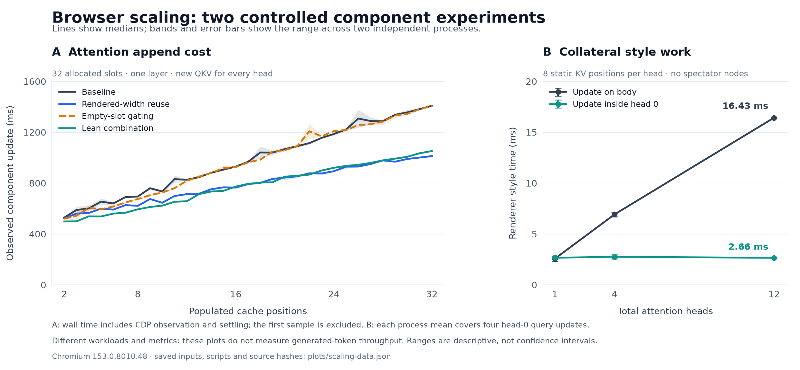

# Scaling investigation: findings and decisions

The strongest result in this investigation is that **moving an update to the subtree that owns
the input can greatly reduce collateral style recalculation**. Adding selective
inheritance rules to the existing shared structure did not achieve that result:
the tested forwarding implementation was substantially slower.

Rendered-value reuse remains useful inside attention, but a component gain has
not established a faster full GPT-2 runtime. The first combined candidate was
**slower** in the short twelve-layer integration run. Production defaults remain
unchanged. Repeated four-token native comparisons give opposing timing results,
so even width reuse alone has not demonstrated a repeatable native speedup here.

| Evidence set | Completed cases | Validation and exclusions |
|---|---:|---|
| Attention variants | 47 | 846 context checks and 10 separate trace updates passed |
| Structural locality | 24 | 96 timed mutations and 12 separate traces passed; one earlier startup failure preserved |
| Native GPT-2 integration | 15 | Token, cache and final-head checks passed; one timing excluded for known CPU contention |
| Native local input commits | 3 | All nine A→B→A commits passed, including delayed-observation checks |

These are separate component workloads. Bands/error bars show the two-process
range, not confidence intervals. [SVG](plots/scaling-investigation.svg) ·
[Plot data and source hashes](plots/scaling-data.json).

## 1. Structural locality works in the diagnostic

The locality probe uses real bilinear-font QK products, CSS softmax/weighted V,
and immutable fixture K/V. It changes the same head-0 inputs either on `body` or
on head 0's owning subtree, while adding unrelated heads.

| Heads | First style event: root update, elements | First style event: local update, elements |
|---:|---:|---:|
| 1 | 76 | 77 |
| 4 | 307 | 77 |
| 12 | 923 | 77 |

At twelve heads, mean measured style time fell from **16.431 to 2.662 ms** without
added spectator nodes, and from **21.950 to 3.102 ms** with 1024 inert spectators
per head. All 24 completed timing cases and 12 separate diagnostic traces passed.
One earlier browser-startup failure is preserved separately; its retry passed.
Unrelated heads' computed outputs remained unchanged at CSS serialization
precision and matched their numerical references.

This does **not** show that every browser operation was repeated before isolation.
Both versions had nine shaping events and the same layout dirty-object counts
in the traced update. The measured difference is extra style recalculation.
Trace element counts are not counts of physical property copies or every node
visited internally.

A real layer pass changes the queries of **all twelve heads**. The diagnostic
deliberately changes only one head to expose collateral invalidation; its roughly
sixfold style-time ratio cannot be applied to a complete layer pass. Production
tests must include simultaneous all-head changes and measure work in inactive
banks or other stages, alongside the added cost of local input delivery.

**Decision:** pursue structural input/control ownership. Do not claim that this
prototype already implements production KV retention, layer selection or a
native all-head completion barrier.

Evidence: [locality report](locality-report.md),
[timing and trace summary](locality/summary.json).

## 2. Selectively forwarding cache fields regressed

The `fields` variant makes exported cache aliases non-inheriting and explicitly
forwards only relevant fields into score and value leaves. It remains correct,
but the measured implementation incurs substantially more style work while
forwarding through the shared spine. This ablation does not isolate which
forwarding submechanism accounts for the increase.

Two fresh-process repeats, 32 allocated slots and four populated positions:

| Variant | Warm append component ms | Mean style ms per append | Mean layout ms per append |
|---|---:|---:|---:|
| Baseline | 584.9 | 103.3 | 92.7 |
| Selective fields | 986.2 | 525.8 | 97.4 |
| All changes including selective fields | 1025.4 | 594.5 | 55.6 |

Wall values are medians of process medians; renderer values are medians of
per-process means. Each append summary covers positions two through four, not
32 populated slots. One independent process is the repetition unit.

**Decision:** reject this forwarding implementation. Its lower logical exposure
of cache fields is insufficient evidence of efficiency. The result does not
reject non-inheriting properties generally, and it does not establish Chromium's
internal reason for the added cost.

Evidence: [all component measurements](MEASUREMENTS.md),
[implementation and interpretation review](methodological-review.md).

## 3. Empty slots help early; rendered-V reuse helps full attention

The `empty` variant leaves native cache storage intact, but hides score/value
glyphs until their slot is populated. It also removes the hidden glyphs' positive
base widths from the final subtraction. Omitting this compensation would change
the numerical result.

At four populated positions in a 32-slot allocation, its append median fell
from **584.9 to 526.2 ms**, roughly 10%. The `lean` combination (width reuse,
empty-slot gating, input materialization and local score timelines) reached
**502.3 ms**, roughly 14% below baseline. All matched early-prefix runs passed.

The full-capacity screen fills every slot before its final append and query
probes. The following ranges are the two independent runs, not confidence
intervals:

| Variant | Append at position 32, ms | Fixed-K/V query probe median, ms |
|---|---:|---:|
| Baseline | 1405.3–1412.2 | 565.8–574.3 |
| Rendered-width reuse | 1003.8–1022.0 | 554.0–626.9 |
| Empty-slot gating | 1401.7–1412.7 | 584.3–597.9 |
| Lean combination | 1051.9–1052.7 | 577.1–579.7 |

At position 32, width reuse cuts the measured append cost by about **28%**, with
layout duration falling from roughly **758 to 419 ms**. Style time does not fall
in that comparison. Empty-slot gating provides no corresponding full-occupancy
benefit. The fixed-K/V probe changes only one head's query numerically, whereas
an append changes all heads' QKV; these operations must not be conflated.

The observed curve still grows with history length. Between positions 2 and 32,
baseline append latency rises from **529 to 1409 ms**; width reuse rises from
**522 to 1013 ms**. Reuse reduces that growth over the measured range but does
not make the operation constant-cost. A new query still needs new attention
scores and a new weighted sum over the retained history. Avoiding unrelated
browser work cannot remove those actual dependencies.

Every one of the eight full-capacity runs passed all 35 context checks. Worst
observed RMSE was below 0.0009 against the independent synthetic-input oracle.
These are externally driven attention operations, not generated-token times.

**Decision:** retain width reuse as an opt-in component candidate. Empty-slot
gating is an early-prefix optimization, not a solution to full-cache scaling.
Layer switching and end-to-end behavior still determine whether either helps
the actual model.

### Layer revisits weaken the reuse claim

Distinct synthetic K/V histories were written into each layer bank and revisited.
The two-layer matrix has two fresh-process repeats per variant; the twelve-layer
matrix has one. Append numbers exclude the first sample; query-plus-layer-switch
updates change one head's query and select another layer's retained history.

| Component setup | Baseline append median | Width reuse | Lean combination |
|---|---:|---:|---:|
| 2 layers, 8 positions | 404–416 ms | 376–385 ms | 353–364 ms |
| 12 layers, 4 positions | 356.9 ms | 351.3 ms | 339.8 ms |

The two-layer query-plus-layer-switch medians clustered around 328–341 ms across
the variants. At twelve layers they were **381.1, 380.7 and 386.3 ms** respectively.
Thus these measurements do not show a useful layer-switch benefit from width
reuse. The smaller capacity of the twelve-layer component prevents comparing its
absolute latency to the two-layer case as a pure layer-count scaling curve.
All nine cases, 312 context checks and nine separate diagnostic traces passed.

## 4. Short native integration does not establish a speedup

All six initial native cases use a full 50,257-token vocabulary head and native
autoregressive feedback with **zero post-navigation writes and no JavaScript**.
The two-layer cases use the matching truncated-model reference. Both twelve-layer
cases also match the original floating-point winning tokens.

| Model/test | Baseline total | Lean total | Observed result |
|---|---:|---:|---|
| 2 real layers, 4 generated positions | 47.23 s | 43.44 s | 8.0% lower in one run |
| 12 real layers, 2 generated positions | 82.73 s | 91.97 s | **11.2% higher** in one run |

The twelve-layer first-token times are similar: 44.81 versus 44.54 seconds.
Its only subsequent interval is also the terminal interval, so it cannot be
called steady-state throughput. That interval increases from **37.91 to 47.43 s**.
Renderer style time during it increases from **19.27 to 26.26 s**. Lower peak
sampled RSS in the lean case (3421 to 3168 MiB) does not offset the slower run.

Native feedback, retained layer/slot cache values and final head inputs were
checked independently. The implementation is composable and correct on these
tests; the timing claim is much weaker. This is one short trajectory per variant,
and no new 32-token full-model run has demonstrated improvement over the earlier
52m57s result.

**Decision:** do not promote the bundle. Each constituent change was subsequently
run separately through the same twelve-layer/two-token setup. All four additional
cases passed token, cache and final-head checks, with zero post-navigation writes.

| Native variant | Total two-token time | Final interval | Style time during final interval |
|---|---:|---:|---:|
| Earlier baseline | 82.73 s | 37.91 s | 19.27 s |
| Earlier lean | 91.97 s | 47.43 s | 26.26 s |
| Width reuse | 70.09 s | 31.43 s | 15.89 s |
| Empty-slot gating | 77.47 s | 39.10 s | 20.67 s |
| Raw-QKV reset (`materialize`) | 87.24 s | 46.18 s | 27.46 s |
| Local score timelines | 81.24 s | 40.01 s | 23.47 s |

The raw-QKV reset alone shows a style-time increase similar to the bundle. That
makes it a plausible contributor; this screen does not rule out interactions or
temporal drift against the earlier baseline. Empty-slot gating and local timeline
scope do not improve the fully populated final interval in these runs.

Width reuse is the strongest candidate here, but its sampled peak renderer RSS
is **4239 MiB versus 3421 MiB** for the earlier control. This single short result
warrants a fresh comparison including continuing intervals, not a claim about the
old 32-token workload. The [native report](native-report.md) retains all counters,
errors, source records and the subsequent repeated four-token comparison.

### Fresh four-token comparisons did not reproduce a consistent benefit

Two clean fresh-process pairs used all twelve layers, four generated tokens,
identical prompts and opposite execution orders: baseline→widths, then
widths→baseline. Relevant compiler/harness source hashes matched, and repeated
compiled artifacts were byte-identical within each variant. Each case retains
its generated page and artifact hashes for inspection.

| Repeat | Baseline total | Width-reuse total | Width reuse relative to baseline |
|---|---:|---:|---:|
| 2: baseline first | 162.13 s | 151.95 s | 6.3% less time |
| 1: widths first | 144.10 s | 163.91 s | 13.7% more time |

The continuing-token intervals also vary: baseline **36.34/40.55 s** versus
widths **33.67/36.97 s** in the first pair; baseline **32.94/33.65 s** versus
widths **35.35/44.79 s** in the reversed pair. Terminal intervals are recorded
separately in the native report. These opposing comparisons do not justify a
stable speedup percentage, including one obtained by averaging them together.

There is no repeatable memory advantage either. Baseline sampled renderer peaks
were **3601 and 4844 MiB**; widths peaks were **4236 and 3969 MiB**, respectively.
One or two processes per configuration cannot identify the cause of this
variation or establish a stable memory/time tradeoff.

All four clean cases generated `[11, 314, 1101, 7926]`, matching both quantized
and floating-point reference winners. Each checked 48 retained layer/slot pairs
and its final vocabulary result against the actual browser input, with zero
post-navigation writes. A fifth four-token baseline also passed correctness,
but its timing was excluded because a source-analysis process overlapped it
for approximately 40 seconds. Its original 153.99-second result and incident
record are preserved; it was not used to select the favorable comparison.

**Decision:** retain the component result, reject a repeatable native speedup
claim, and leave production defaults unchanged. No new full-context native run
has improved on the historical 32-token result.

## 5. What the other methods actually tested

| Method | What was attempted | Current interpretation |
|---|---|---|
| Local stage controls | Narrow attention score timeline scope; review existing private layer controller | Correct; no convincing independent component win in the early repeated screen. Not a new commit protocol. |
| Raw-input lifetime (`materialize`) | Reset 2304 spent raw QKV fields at the first bank; baseline already derives axis lists/scales | Correct; small/no early component effect. Its short native run regressed, making it a plausible contributor to the bundle's slowdown. |
| Layout containment | Compare strict, size+layout, and no containment on fixed-size attention scrollers | Correct on tested geometry; append changes at early prefix are small/inconclusive. |
| Deeper operator fusion | Audit existing bias/GELU/residual/softmax fusions and remaining geometry-to-number boundaries | Existing fusions were not counted as new work. No new fused operator was falsely benchmarked. |
| Native local commits | Build a two-head source→reader→held-bank mechanism with A→B→A changes and source poisoning | All nine commits in three browser processes passed; establishes native capture/retention, with no speedup claim. |

The [raw-QKV reset audit](materialization-notes.md) found byte-identical native
HTML and only one added CSS rule: 42,797 bytes resetting those 2,304 properties.
Their direct consumers are upstream, but 72 derived input properties, layer/pass
controls and the shared attention structure remain connected. The reset also
leaves the sibling context-receiver/MLP branch outside its scope. The native
style increase therefore warrants further attribution; it cannot be explained
as evidence that all raw values were previously being copied or recomputed.

A final matched twelve-layer/four-position attention test did **not** reproduce
that native regression. With all 60 contexts and its separate trace passing,
the reset variant's append median was **350.8 versus 356.9 ms** for baseline;
query-plus-layer-switch was **376.7 versus 381.1 ms**. Renderer style time was
also nearly neutral. This is one later process against the earlier source-matched
control. It narrows the evidence, but cannot distinguish a full-graph interaction
from variability in the single native reset run.

The native-local-commit probe connects an externally localized mutation to a
script-free producer/consumer implementation. A single reusable input bank
receives and holds a 64-coordinate query for one of two real attention heads.
After capture, the upstream source is deliberately replaced with a different
vector and a negative tag; the held input and output retain their correct
positive tag and values. All nine A→B→A commits across three fresh browser
processes passed, with maximum attention-output RMSE **0.000028696** and zero
post-navigation writes.

The strongest delayed-observation case reached its completion marker before the
first computed-style read. In the normally observed run, the unrelated head's
output remained exactly unchanged across eight valid snapshots. The delayed
runs have only one observed snapshot and cannot establish continuous invariance.

This is serialized reuse of one bank, not overlapping double buffering. It adds
bridge/audit work and has no matched broadcast timing comparison, so it establishes
neither a speedup nor reduced style invalidation. Production layer-bank selection,
full 768-coordinate transport and all-head completion remain to integrate and
measure. See the [native local-commit report](native-local-commits.md).

## 6. Which experiment should come next

1. **Integrate ownership at one real stage boundary.** Give each head a held input
   bank and keep its changing controls local. Add a generation-aware completion
   barrier so the output projection cannot combine different layer passes. Check
   retained K/V and the full context before measuring whether saved style work
   exceeds the extra native transport cost. The current local-commit fixture is
   deliberately too small to answer that cost question.
2. **Separate persistent representation from selected-layer reuse.** Keeping a
   width stable while one layer runs is different from preserving twelve layers'
   rendered widths. A per-layer rendering design must measure its extra resident
   memory as well as layer-switch time. Start with matched capacity and population
   at 1, 2 and 12 layers; current mixed-capacity matrices cannot supply that curve.
3. **Require a continuing native sequence before promotion.** A candidate should
   first beat a matched control across repeated short runs containing several
   nonterminal intervals, then pass a full-context native comparison. Preserve
   token agreement, cache errors, startup cost and sampled memory alongside time.
   The old 52m57s measurement cannot be multiplied by a component percentage to
   predict the result.

Explicit cache forwarding is not the next candidate: its repeated regression is
large enough to reject this implementation. Empty-slot gating can remain an
optional early-prefix optimization. The materialization and timeline results
should guide whether those changes belong in any subsequent candidate at all.

## Reproduction and evidence integrity

- [README](README.md): experiment definitions, contracts, commands and work log.
- [MEASUREMENTS](MEASUREMENTS.md): generated tables, repeat pairing, per-position
  checkpoints, raw result inventory and source revisions.
- [ARCHITECTURE](ARCHITECTURE.md): data ownership, existing fusion and unresolved
  native transport/barrier requirements.
- [Methodological review](methodological-review.md): what each observation proves,
  pooling/terminal-token caveats, and remaining coverage limits.
- [Raw-QKV reset audit](materialization-notes.md): exact generated-page difference,
  remaining dependencies, unmeasured engine hypotheses and falsification tests.
- [Locality](locality-report.md), [native pipeline](native-report.md), and
  [native local commits](native-local-commits.md): specialized protocols/results.

Five no-browser regression tests protect evidence handling: compiler failures are
saved, failed traces remain failures on rerun, mismatched configurations cannot
reuse results silently, successful files are preserved, and invalid counts are
rejected. Source syntax and Ruff checks pass for all eight new investigation
scripts; documentation links and the rendered figure were checked. Exact source
bytes before final lint cleanup are retained in
[the source archive](source-before-final-lint/manifest.json), alongside the
per-measurement manifests and their earlier source snapshots.
Every browser failure or incomplete attempt is retained and labeled; only complete
passing runs enter the primary timing aggregates.

The investigation uses three subagents for independent implementation, native
validation, and analysis. Browser workloads ran serially; the known CPU-contention
exception and excluded timing are documented above. `uv cache prune` reclaimed
2.8 GiB of unused package cache with user
authorization; model assets, previous experiment results and production sources
were preserved.
