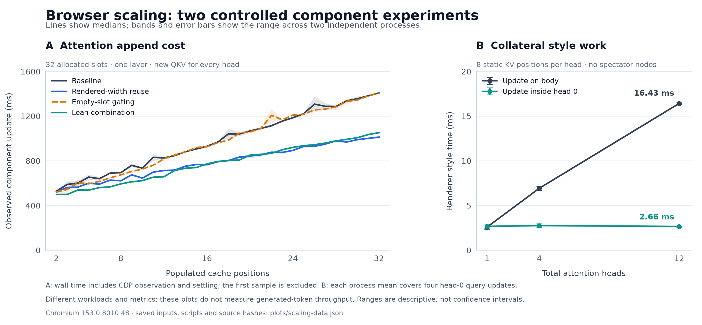

# Scaling figure and reproducible data



The figure has two separate panels. The left shows native attention component
append updates at positions 2–32 in a 32-slot allocation, with one selected layer.
The first settled sample is omitted. All heads receive new QKV on each append.
The right shows renderer style work when only head 0's query/tick changes, while
the number of static attention heads grows. Every head has eight populated
positions and there are no added spectator nodes.

Each line is the median across two independent browser processes per condition;
bands/error bars show their minimum and maximum. Each locality point first
averages four mutations within its process. These are descriptive ranges, not
confidence intervals. The panels use different workloads and metrics, and
neither is an end-to-end token-generation measurement.

Outputs:

- [PNG](scaling-investigation.png), 2,484 × 1,152 pixels.
- [Editable SVG](scaling-investigation.svg).
- [Exact plotted data and all 20 input result hashes](scaling-data.json).
- [Renderer version, output/data/script hashes](render-manifest.json).
- [Plotting script](../../../tools/plot_browser_gpt2_scaling_investigation.py).

From the repository root:

```sh
python3 tools/plot_browser_gpt2_scaling_investigation.py --data-only
uv run --no-build tools/plot_browser_gpt2_scaling_investigation.py
```

The first command only uses the Python standard library. The second resolves the
script's inline Matplotlib dependency in a UV-managed environment; it does not
change the project's dependency files and prohibits source builds. This figure
was rendered with Matplotlib 3.11.2 after all browser benchmarks finished.

The loader checks passing results, exact configuration/position/repetition
identity and matching recorded sources/browser. Full-attention records also
contain matching non-null Python/platform/package/fixture-seed metadata. Earlier
locality records lack that environment manifest; the loader instead verifies
their recorded source/browser identity and identical active-head input hash,
without treating missing metadata as proof of environment identity.
